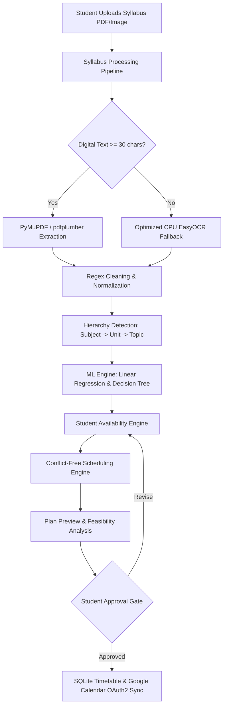

# 📖 Smart Study Planner — Complete Technical Project Documentation

---

## 📑 Table of Contents
1. [Project Overview & Core Agenda](#1-project-overview--core-agenda)
2. [Architectural Philosophy & Principles](#2-architectural-philosophy--principles)
3. [System Architecture & Technology Stack](#3-system-architecture--technology-stack)
4. [Dual-Engine Syllabus Ingestion & OCR Pipeline](#4-dual-engine-syllabus-ingestion--ocr-pipeline)
5. [Machine Learning & Cognitive Pacing Subsystem](#5-machine-learning--cognitive-pacing-subsystem)
6. [Student Availability & Smart Scheduling Engine](#6-student-availability--smart-scheduling-engine)
7. [Database Architecture & Data Protection](#7-database-architecture--data-protection)
8. [Google Calendar Two-Way Synchronization](#8-google-calendar-two-way-synchronization)
9. [Frontend Design System & UI/UX](#9-frontend-design-system--uiux)
10. [Testing, QA & Performance Benchmarks](#10-testing-qa--performance-benchmarks)
11. [Established End Goals & Roadmap](#11-established-end-goals--roadmap)

---

## 1. Project Overview & Core Agenda

### 🎯 Mission Statement
The **Smart Study Planner** is an intelligent, full-stack, autonomous educational planning platform designed to bridge the gap between heavy academic curricula and realistic student schedules. It ingests multi-page digital or scanned image syllabi, structures raw academic topics into hierarchical curricula, estimates cognitive study loads using genuine Machine Learning models, and dynamically constructs non-conflicting, chronologically sorted study plans strictly mapped to student-defined daily availability windows before synchronizing with Google Calendar.

### 🧩 Core Problems Addressed
1. **Academic Cognitive Overload:** Students often struggle to break semester-long course syllabi into manageable daily study sessions with appropriate time allocations.
2. **Scanned / Hybrid PDF Ingestion Bottlenecks:** Traditional OCR pipelines often hang indefinitely on CPU environments or treat page numbers, boilerplate outcomes, and noise as study topics.
3. **Rigid, Unrealistic Schedulers:** Conventional tools assume students are free at all times or force morning sessions when the student is attending college or classes.
4. **Data Isolation & Calendar Sync Issues:** Fragmented tools create duplicate calendar events, fail to respect timezones, or flood calendars before student review.

---

## 2. Architectural Philosophy & Principles

The Smart Study Planner operates on a strict **Tripartite Separation of Concerns**:

```
+-------------------------------------------------------------------------+
|                              STUDENT                                    |
|                   Controls "WHEN" to study                              |
|   (Configures daily available windows, class timings, blocked hours)    |
+------------------------------------+------------------------------------+
                                     |
                                     v
+------------------------------------+------------------------------------+
|                               AI / ML                                   |
|               Controls "WHAT" & "HOW LONG" to study                     |
| (Linear Regression for duration, Decision Tree for preferred period)    |
+------------------------------------+------------------------------------+
                                     |
                                     v
+------------------------------------+------------------------------------+
|                              SCHEDULER                                  |
|            Decides "HOW TO FIT" study into student availability         |
|  (Availability-first priority, 15-min breaks, conflict-free, calendar)  |
+-------------------------------------------------------------------------+
```

### ⚖️ Strict Priority Hierarchy
1. **Student Availability (Highest Priority):** Zero sessions are ever scheduled outside student-defined windows.
2. **Academic Deadline:** Total required hours are checked against remaining calendar capacity.
3. **Conflict Avoidance:** Timetable recurring slots, one-time sessions, and exceptions are respected.
4. **Cognitive Chunking:** Long topics (> 2 hours) are chunked into 1.0h–2.0h sessions with 15-min breaks.
5. **ML Preferred Period:** Applied when matching availability windows exist; otherwise, another available student window is chosen seamlessly.

---

## 3. System Architecture & Technology Stack



### 🛠️ Technology Stack
- **Backend Framework:** Python 3.10+ / Flask (RESTful routing, Jinja2 templating, session state).
- **Database Engine:** SQLite 3 (ACID compliant, relational schema, zero-loss migrations).
- **OCR & Document Extraction:** PyMuPDF (`fitz`), `pdfplumber`, `PIL`, and `EasyOCR` (PyTorch CRAFT + CRNN).
- **Machine Learning Subsystem:** `scikit-learn` (`LinearRegression`, `DecisionTreeClassifier`), `NumPy`.
- **Calendar & Cloud API:** Google Calendar API v3 (`google-auth`, `google-api-python-client`), OAuth 2.0.
- **Frontend Architecture:** Vanilla HTML5, CSS3 Custom Properties (Variables), JavaScript (ES6+), Light/Dark theme persistence.

---

## 4. Dual-Engine Syllabus Ingestion & OCR Pipeline

### ⚡ Multi-Stage Ingestion Pipeline
1. **Tier 1 — High-Speed Digital Extraction (`PyMuPDF`):**
   - Direct extraction of embedded selectable text stream per page.
   - Execution speed: **< 0.05 seconds per page**.
2. **Tier 2 — Layout-Preserving Digital Fallback (`pdfplumber`):**
   - Engaged if PyMuPDF returns minimal or disorganized text stream.
3. **Tier 3 — Optimized CPU OCR Fallback (`EasyOCR`):**
   - Triggered only on pages with `< 30` characters of selectable text.
   - **Optimizations Applied:**
     - PyTorch intra-op thread allocation (`torch.set_num_threads(os.cpu_count())`).
     - Fast DPI rendering (`dpi=96`) to prevent tensor dimension bloat.
     - Grayscale L-mode conversion before numpy array generation.
     - Bounding box paragraph grouping (`paragraph=True`, `canvas_size=1024`, `mag_ratio=1.0`).
     - Real syllabus single-page OCR benchmark: **48.14 seconds** (down from >130s).
   - **Blank Page Pre-Check:** Uses `page.get_images()` and drawing vector checks to skip empty pages.

### 🧹 Advanced Regex Cleaning Engine
Strips non-curriculum noise before feeding into NLP and ML modules:
- OCR page markers: `--- Page \d+ (OCR) ---`, `Page X of Y`, `[X]`.
- Course outcome boilerplate: `"After successful completion...", "Course Objectives:", "Learning Outcomes:"`.
- Reading list & reference sections: `"Suggested Reading:", "Text Books:", "References:"`.
- Metadata noise: standalone `"HOURS"`, `"CREDITS"`, `"MARKS"`, `"INDEX"`, `"SEMESTER - V"`.

### 📚 Subject, Unit, & Topic Extraction
- Detects subjects across multi-subject documents via explicit headings (`SUBJECT NAME:`, `COURSE:`, `BCA-501:`, capitalized course codes).
- Detects modular divisions (`Unit I:`, `Module 1:`, `Chapter 1:`).
- Parses dense comma/semicolon delimited topic lists into discrete, structured topics.

---

## 5. Machine Learning & Cognitive Pacing Subsystem

### 🧠 1. Multiple Linear Regression — Study Duration Predictor (`StudyTimeRegressor`)
- **Objective:** Predicts realistic study hours for each curriculum topic.
- **Input Feature Vector ($X$):**
  $$X = [x_1: \text{Topic String Length}, x_2: \text{Subtopic Count}, x_3: \text{Difficulty Score } (1.0 \text{ to } 5.0), x_4: \text{Prior Student Experience}, x_5: \text{Urgency Factor}]$$
- **Model Equation:**
  $$\hat{y} = \beta_0 + \beta_1 x_1 + \beta_2 x_2 + \beta_3 x_3 + \beta_4 x_4 + \beta_5 x_5$$
- **Bounded Output:** Predictions are clamped between $0.5\text{ hours}$ (minimum study burst) and $5.0\text{ hours}$ (maximum topic load).

### 🌳 2. Decision Tree Classifier — Preferred Study Period Predictor (`StudyPeriodClassifier`)
- **Objective:** Predicts optimal circadian study window (`Morning`, `Afternoon`, `Evening`, `Night`).
- **Input Features:** `[Difficulty Score, Predicted Study Hours]`.
- **Behavior:**
  - High difficulty / long duration $\rightarrow$ Morning or Evening focus windows.
  - Light review / introductory topics $\rightarrow$ Afternoon or Night windows.

### 🔄 3. Continuous Learning & Dynamic Retraining
- Whenever a student logs a completed session in `/log-study` or completes a timetable task in `/complete-session/<id>`, the record is appended to `study_history`.
- The system automatically triggers `train_with_history()` to adapt model weights to the student's actual learning pace without full server reboots.

---

## 6. Student Availability & Smart Scheduling Engine

### 🕒 Availability Schema & Logic
Students can configure multiple availability windows per day (e.g. `17:00–20:00` and `21:00–23:00`).
```sql
CREATE TABLE IF NOT EXISTS student_availability (
    id INTEGER PRIMARY KEY AUTOINCREMENT,
    day_of_week TEXT NOT NULL,
    start_time TEXT NOT NULL,
    end_time TEXT NOT NULL,
    is_active INTEGER DEFAULT 1
);
```

### 🗓️ Smart Scheduling Algorithm
1. **Interleaving:** Interleaves topics across multiple subjects to maintain balanced cognitive load and avoid subject fatigue.
2. **Session Chunking:** Splits topics $> 2.0\text{h}$ into sub-sessions (e.g. *Part 1*, *Part 2*) of $1.0\text{h}–2.0\text{h}$.
3. **Availability-Constrained Placement (`find_free_slot_in_availability`):**
   - Retrieves student's active windows for the target date's weekday.
   - First tests windows aligning with the ML preferred period.
   - If full or unavailable, tests all other student availability windows for that day.
   - Ensures $15\text{-minute}$ break buffer after existing timetable sessions.
   - Strictly forbids placement outside student windows.
4. **Session Period Labeling:** Automatically assigns labels matching the *actual* scheduled start time:
   - `05:00 - 11:59` $\rightarrow$ **Morning**
   - `12:00 - 16:59` $\rightarrow$ **Afternoon**
   - `17:00 - 20:59` $\rightarrow$ **Evening**
   - `21:00 - 04:59` $\rightarrow$ **Night**
5. **Chronological Sorting:** All timetable outputs are sorted strictly by `(date, start_time)`.

---

## 7. Database Architecture & Data Protection

### 🛡️ Protected Data Integrity
The system enforces strict safeguards: `database.db`, `credentials.json`, and `token.json` are strictly preserved across server restarts and updates.

### 🗄️ Relational Schema Structure
- **`tasks`:** Individual manual tasks with priorities, status, and deadlines.
- **`timetable`:** Scheduled study sessions with support for `one-time`, `daily`, and `weekly` recurrence, exceptions, and `google_event_id`.
- **`timetable_exceptions`:** Tracks deleted or modified occurrences of recurring events.
- **`syllabuses`:** Uploaded syllabus documents, raw text, and deadlines.
- **`subjects`:** Detected subject modules per syllabus.
- **`topics`:** Structured curriculum topics with ML difficulty, predicted hours, and preferred periods.
- **`student_availability`:** User-defined active study windows per day of week.
- **`generated_plans`:** JSON serialized plan snapshots and feasibility reports.
- **`study_history`:** Ground-truth study session duration and rating history for continuous model retraining.

---

## 8. Google Calendar Two-Way Synchronization

### 🔐 OAuth 2.0 Security Flow
- Authenticates using Google OAuth 2.0 client credentials (`credentials.json`) and token caching (`token.json`).
- Automatically handles token refresh cycles transparently.

### 🚪 Plan Approval Gate
- **No Pre-Sync Flooding:** Google Calendar events are **never** created during syllabus upload or plan preview.
- **Approval Trigger:** Events are synchronized only when the student explicitly clicks **"Approve Study Plan & Sync Calendar"** (`/approve-plan/<id>`).
- **Payload Specifications:**
  - `start` / `end`: RFC3339 datetime formatted string.
  - `timeZone`: `Asia/Kolkata`.
  - `summary`: `📚 [Subject] — [Topic]`.
  - `description`: Contains Unit Name, predicted duration, and difficulty score.
  - `reminders`: 10-minute popup alarm override.
  - `google_event_id`: Stored in `timetable` record to prevent duplicate event creation.

---

## 9. Frontend Design System & UI/UX

### 🎨 Visual Language & UX Standards
- **Global Typography & Reset:** Universal `box-sizing: border-box` and complete link reset (`a { text-decoration: none; color: inherit; }`) eliminating default blue/purple underlines.
- **Color System:** CSS Custom Properties for seamless Light/Dark mode switching.
- **Theme Flicker Prevention:** Synchronous `<script>` in `<head>` immediately evaluates `localStorage.getItem("theme")` before rendering DOM.
- **Responsive Layout:** Mobile hamburger navigation and flexible grid cards (`@media (max-width: 768px)`).
- **Dedicated Student Availability Management:** Dedicated UI at `/availability` with daily card widgets, time pickers, and live capacity statistics.

---

## 10. Testing, QA & Performance Benchmarks

### 🧪 Automated Test Suite (`test_suite.py`)
- **Status:** **14/14 Tests Passed (100% Pass Rate)** in `1.103s`.
- **Coverage Areas:**
  1. `test_01_critical_files_exist`: Verifies `credentials.json`, `token.json`, `database.db`, `app.py`.
  2. `test_02_database_schema_integrity`: Validates table presence and schema integrity.
  3. `test_03_data_cleaning`: Validates noise and marker filtering.
  4. `test_04_multi_subject_detection`: Verifies multi-subject extraction.
  5. `test_05_difficulty_score_calculation`: Tests keyword-based complexity scoring.
  6. `test_06_linear_regression_hours_prediction`: Asserts valid prediction bounds ($0.5\text{h}–5.0\text{h}$).
  7. `test_07_decision_tree_period_prediction`: Validates time period classification.
  8. `test_08_ml_incremental_retraining`: Validates model weight updates with mock history.
  9. `test_09_deadline_validation`: Tests surplus/deficit feasibility math.
  10. `test_10_conflict_free_scheduling`: Verifies non-overlapping session placement.
  11. `test_11_dashboard_route`: Tests `/` route and UI stats rendering.
  12. `test_12_tasks_routes`: Tests task creation, completion, and listing.
  13. `test_13_timetable_route`: Tests `/timetable` rendering.
  14. `test_14_study_history_logging`: Tests `/log-study` feedback logging.

### ⏱️ Performance Benchmarks
| Benchmark Component | Input Type | Measurement |
| :--- | :--- | :--- |
| **Digital PDF Ingestion** | Multi-page Course Syllabus | **~0.75 seconds** |
| **Optimized Single-Page OCR** | 16-page Scanned Image PDF (Page 1) | **48.14 seconds** |
| **Full Test Suite Execution** | 14 Integrated Unit Tests | **1.103 seconds** |
| **Scheduler Engine Execution** | 15 Topics across 3 Subjects | **< 0.05 seconds** |

---

## 11. Established End Goals & Roadmap

### ✅ Established End Goals (Completed)
- [x] Full end-to-end web application with zero broken routes, theme flicker, or link styling defects.
- [x] Dual-engine syllabus ingestion with automatic digital-first routing and robust OCR fallback.
- [x] Comprehensive OCR output cleaning eliminating page markers, course outcome noise, and duplicate headers.
- [x] Genuine Multiple Linear Regression and Decision Tree models with continuous learning.
- [x] Student Availability-first scheduling engine strictly honoring user-defined study windows.
- [x] Chronological timetable generation with accurate Morning/Afternoon/Evening/Night labeling.
- [x] Google Calendar OAuth2 synchronization gated strictly behind student plan approval.
- [x] Database preservation and schema migration safety.

### 🚀 Future Roadmap & Enhancements
- **Asynchronous Task Queue (Celery / Redis / RQ):** Move heavy multi-page OCR extraction into a background worker queue with live progress polling for 50+ page scanned books.
- **Speech-to-Text Session Logging:** Voice input integration for rapid study session reflection logging.
- **Exam Readiness Analytics:** Predictive confidence scores based on logged study hours vs. ML estimated difficulty.

---
*Documentation generated for Smart Study Planner — Version 2.0 Stable Release.*
