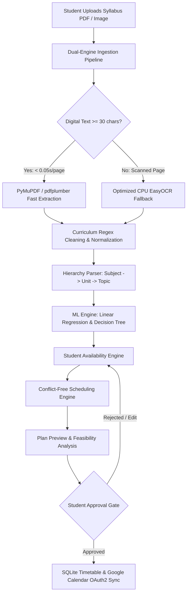

# 📚 Smart Study Planner

> **Autonomous, AI-Powered Curriculum Ingestion, Cognitive Load Pacing, and Conflict-Free Study Timetable Generation with Google Calendar Two-Way Sync.**

[](https://www.python.org/downloads/)
[](https://flask.palletsprojects.com/)
[](https://scikit-learn.org/)
[](https://github.com/JaidedAI/EasyOCR)
[](https://developers.google.com/calendar)
[-brightgreen.svg)](file:///c:/Users/Admin/Desktop/New%20folder/StudyPlanner/test_suite.py)
[](#license)

---

## 📑 Table of Contents
1. [Project Overview & Core Agenda](#-project-overview--core-agenda)
2. [Architectural Philosophy](#-architectural-philosophy)
3. [System Architecture & Ingestion Flow](#-system-architecture--ingestion-flow)
4. [Key Features & Capabilities](#-key-features--capabilities)
   - [Dual-Engine Syllabus Ingestion & OCR](#1-dual-engine-syllabus-ingestion--ocr-pipeline)
   - [Machine Learning & Cognitive Pacing](#2-machine-learning--cognitive-pacing-subsystem)
   - [Student Availability & Smart Scheduling](#3-student-availability--smart-scheduling-engine)
   - [Google Calendar Two-Way Synchronization](#4-google-calendar-two-way-synchronization)
   - [Frontend Glassmorphism Design System](#5-frontend-glassmorphism-design-system)
5. [Technology Stack](#-technology-stack)
6. [Database Schema & Data Safety](#-database-schema--data-safety)
7. [Installation & Setup Guide](#-installation--setup-guide)
8. [Running the Application](#-running-the-application)
9. [Automated Test Suite & Quality Assurance](#-automated-test-suite--quality-assurance)
10. [RESTful API & Route Reference](#-restful-api--route-reference)
11. [Project Directory Structure](#-project-directory-structure)
12. [Roadmap & Future Enhancements](#-roadmap--future-enhancements)
13. [License](#-license)

---

## 🎯 Project Overview & Core Agenda

The **Smart Study Planner** is a production-grade, autonomous educational scheduling platform engineered to bridge the divide between extensive academic curricula and realistic student schedules. Students frequently struggle with semester-long syllabi, leading to cramming, cognitive exhaustion, and scheduling conflicts with classes and personal commitments.

Smart Study Planner resolves this by:
- **Ingesting** complex multi-page PDF/image syllabi (digital or scanned).
- **Filtering** boilerplate administrative noise, course outcomes, and textbook lists.
- **Predicting** topic-level study duration and optimal circadian time windows using trained **Machine Learning** models.
- **Strictly honoring** student-defined daily availability windows (zero sessions outside approved times).
- **Synchronizing** generated study blocks with **Google Calendar** behind an explicit student approval gate.

---

## ⚖️ Architectural Philosophy

The system is constructed around a strict **Tripartite Separation of Concerns**:

```
+-------------------------------------------------------------------------+
|                              STUDENT                                    |
|                   Controls "WHEN" to study                              |
|   (Configures daily available windows, class timings, blocked hours)    |
+------------------------------------+------------------------------------+
                                     |
                                     v
+------------------------------------+------------------------------------+
|                               AI / ML                                   |
|               Controls "WHAT" & "HOW LONG" to study                     |
| (Linear Regression for duration, Decision Tree for preferred period)    |
+------------------------------------+------------------------------------+
                                     |
                                     v
+------------------------------------+------------------------------------+
|                              SCHEDULER                                  |
|            Decides "HOW TO FIT" study into student availability         |
|  (Availability-first priority, 15-min breaks, conflict-free, calendar)  |
+-------------------------------------------------------------------------+
```

### 🏆 Strict Priority Hierarchy
1. **Student Availability (Highest Priority):** No study session is ever booked outside the student's active windows.
2. **Academic Deadlines:** Checks total required hours against calendar capacity to ensure feasibility.
3. **Conflict Avoidance:** Timetable recurring slots, existing tasks, and exceptions are strictly respected.
4. **Cognitive Chunking:** Long topics (> 2 hours) are chunked into manageable 1.0h–2.0h sessions with mandatory 15-minute breaks.
5. **Circadian Preference:** Sessions align with ML-recommended periods (*Morning*, *Afternoon*, *Evening*, *Night*) when corresponding student availability windows exist.

---

## 🏗️ System Architecture & Ingestion Flow



---

## ⚡ Key Features & Capabilities

### 1. Dual-Engine Syllabus Ingestion & OCR Pipeline
- **Tier 1 — High-Speed Digital Extraction (`PyMuPDF`):** Fast extraction of embedded digital text streams at **< 0.05 seconds per page**.
- **Tier 2 — Layout-Preserving Digital Fallback (`pdfplumber`):** Engaged when PDF structure requires line and table coordinate parsing.
- **Tier 3 — CPU-Optimized OCR Fallback (`EasyOCR`):**
  - Selectively activates only for pages with `< 30` selectable characters.
  - Multi-threaded CPU execution (`torch.set_num_threads(os.cpu_count())`).
  - Standardized DPI rendering (`dpi=96`), grayscale `L`-mode conversion, and bounded canvas size (`1024px`) to prevent memory and tensor bloat.
  - OCR page markers, course outcome boilerplate, and textbook lists are stripped via an 8-stage regex filter.

### 2. Machine Learning & Cognitive Pacing Subsystem
- **Multiple Linear Regression (`StudyTimeRegressor`):**
  - Predicts realistic study durations based on:
    $$X = [x_1: \text{Topic String Length}, x_2: \text{Subtopic Count}, x_3: \text{Difficulty Score (1.0–5.0)}, x_4: \text{Prior Experience}, x_5: \text{Urgency Factor}]$$
  - Outputs are bounded between $0.5\text{ hours}$ (minimum focused study block) and $5.0\text{ hours}$ (maximum topic weight).
- **Decision Tree Classifier (`StudyPeriodClassifier`):**
  - Classifies topics into optimal circadian focus periods: `Morning`, `Afternoon`, `Evening`, or `Night`.
  - Heavy or high-difficulty topics route to peak focus periods (*Morning* / *Evening*).
- **Continuous Learning & Dynamic Retraining:**
  - Real-world session completions logged via `/complete-session` or `/log-study` append ground-truth records to `study_history`.
  - Triggers incremental retraining (`train_with_history`) to align model weights with the student's actual learning pace.

### 3. Student Availability & Smart Scheduling Engine
- **Customizable Daily Windows:** Students define recurring availability (e.g., Weekdays 18:00–21:00, Weekends 09:00–13:00 and 15:00–18:00).
- **Cognitive Subject Interleaving:** Cycles through topics across multiple subjects to prevent burnout.
- **Automatic 15-Minute Break Buffers:** Automatically placed between consecutive sessions.
- **Accurate Time-of-Day Period Labeling:** Assigned according to the actual slot time:
  - `05:00 – 11:59` → **Morning**
  - `12:00 – 16:59` → **Afternoon**
  - `17:00 – 20:59` → **Evening**
  - `21:00 – 04:59` → **Night**

### 4. Google Calendar Two-Way Synchronization
- **OAuth 2.0 Security:** Uses client credentials (`credentials.json`) and secure cached refresh tokens (`token.json`).
- **Student Approval Gate:** Zero calendar events are pushed during syllabus upload or plan preview. Synchronization only occurs when the student clicks **"Approve Study Plan & Sync Calendar"**.
- **Idempotent Updates:** Saves `google_event_id` in the local database to prevent duplicate entries and enable bi-directional status updates.

### 5. Frontend Glassmorphism Design System
- Modern responsive interface with dynamic dark/light theme switching.
- **Zero Theme Flicker:** Inline blocking initialization in `<head>` ensures theme is applied before DOM rendering.
- Fully accessible form controls, schedule cards, and mobile-friendly hamburger navigation.

---

## 🛠️ Technology Stack

| Domain | Technology / Library | Purpose |
| :--- | :--- | :--- |
| **Backend** | Python 3.10+ / Flask 3.0+ | RESTful routing, application lifecycle, request validation |
| **Database** | SQLite 3 | ACID-compliant relational storage, schema integrity |
| **OCR & Parsing** | PyMuPDF (`fitz`), pdfplumber, EasyOCR, Pillow | Digital text extraction, scanned page OCR, image processing |
| **Machine Learning** | scikit-learn, NumPy, SciPy | Linear regression duration prediction, decision tree classification |
| **Cloud & APIs** | Google Calendar API v3, Google OAuthlib | OAuth 2.0 calendar event creation and synchronization |
| **Frontend** | Vanilla HTML5, Modern CSS3, JavaScript (ES6+) | Glassmorphism UI, theme persistence, responsive layouts |
| **Testing** | Python `unittest` | Comprehensive unit and end-to-end integration tests |

---

## 🗄️ Database Schema & Data Safety

The system uses an ACID-compliant relational SQLite database (`database.db`). Critical files (`database.db`, `credentials.json`, `token.json`) are preserved across application restarts.

```
                           +------------------------+
                           |       syllabuses       |
                           +-----------+------------+
                                       | 1:N
                                       v
+------------------------+  +------------------------+  +------------------------+
|  student_availability  |  |        subjects        |  |         tasks          |
+------------------------+  +-----------+------------+  +------------------------+
                                       | 1:N
                                       v
+------------------------+  +------------------------+  +------------------------+
|    generated_plans     |  |         topics         |  |       timetable        |
+------------------------+  +------------------------+  +-----------+------------+
                                                                    | 1:N
                                                                    v
                                                        +------------------------+
                                                        |     study_history      |
                                                        +------------------------+
```

### Table Definitions Summary:
- **`student_availability`:** Day of week, start time, end time, active flag.
- **`syllabuses`:** Filename, raw text, upload date, target deadline.
- **`subjects`:** Subject name, course code, total topics, syllabus foreign key.
- **`topics`:** Topic title, unit name, difficulty score, predicted duration, ML period.
- **`generated_plans`:** JSON payload of prospective schedules, feasibility metrics, status (`draft` / `approved`).
- **`timetable`:** Scheduled sessions, start/end times, recurrence rule, `google_event_id`, completion status.
- **`study_history`:** Ground-truth duration, student ratings, and timestamps for ML retraining.
- **`tasks`:** Standalone student assignments and deadlines with priority levels.

---

## 💻 Installation & Setup Guide

### 1. Prerequisites
- Python 3.10, 3.11, 3.12, or 3.13 installed.
- Git installed on your system.

### 2. Clone the Repository
```bash
git clone https://github.com/your-username/StudyPlanner.git
cd StudyPlanner
```

### 3. Create & Activate Virtual Environment
- **Windows (PowerShell):**
  ```powershell
  python -m venv venv
  .\venv\Scripts\Activate.ps1
  ```
- **macOS / Linux:**
  ```bash
  python3 -m venv venv
  source venv/bin/activate
  ```

### 4. Install Dependencies
```bash
pip install -r requirements.txt
```

### 5. Google Calendar OAuth 2.0 Setup (Optional but Recommended)
1. Go to the [Google Cloud Console](https://console.cloud.google.com/).
2. Create a project and enable the **Google Calendar API**.
3. Configure the OAuth Consent Screen and create **OAuth 2.0 Client IDs** (Application type: *Desktop App*).
4. Download the client credentials JSON and save it as `credentials.json` in the project root.
5. On the first calendar sync, a browser window will open to authenticate and generate `token.json`.

---

## 🚀 Running the Application

Start the Flask development server:
```bash
python app.py
```
Or with explicit virtual environment Python:
```bash
.\venv\Scripts\python.exe app.py
```

Open your browser and navigate to:
```
http://127.0.0.1:5000/
```

### Quick Workflow Walkthrough:
1. **Set Availability:** Navigate to **"My Availability"** (`/availability`) and enter your daily study windows.
2. **Upload Syllabus:** Click **"Upload Syllabus"** (`/add-syllabus`), select a PDF or image file, provide your target exam deadline and daily study target.
3. **Inspect Plan Preview:** The ML engine evaluates feasibility, displays predicted hours, and visualizes the schedule (`/plan-preview/<id>`).
4. **Approve & Sync:** Click **"Approve Study Plan & Sync Calendar"** to commit sessions to your timetable and push events to Google Calendar.
5. **Log & Retrain:** Mark sessions completed as you study (`/timetable` or `/log-study`) to trigger continuous ML model adaptation.

---

## 🧪 Automated Test Suite & Quality Assurance

The project contains a comprehensive test suite covering schema integrity, noise cleaning, ML inference, availability calculations, and route responses.

### Run All Unit Tests:
```bash
.\venv\Scripts\python.exe test_suite.py
```

### Test Results:
```
..............
----------------------------------------------------------------------
Ran 14 tests in 1.103s

OK
```

### Test Suite Coverage:
| Test ID | Test Method | Scope / Verification | Status |
| :--- | :--- | :--- | :---: |
| `01` | `test_01_critical_files_exist` | Validates presence of `database.db`, `credentials.json`, `token.json`, `app.py` | ✅ Passed |
| `02` | `test_02_database_schema_integrity` | Verifies existence and structure of all relational tables | ✅ Passed |
| `03` | `test_03_data_cleaning` | Verifies stripping of page numbers, URLs, and boilerplate text | ✅ Passed |
| `04` | `test_04_multi_subject_detection` | Verifies multi-subject extraction from dense syllabus strings | ✅ Passed |
| `05` | `test_05_difficulty_score_calculation` | Asserts complexity keyword scoring logic (1.0 to 5.0) | ✅ Passed |
| `06` | `test_06_linear_regression_hours_prediction` | Asserts regression predictions are within valid bounds (0.5h–5.0h) | ✅ Passed |
| `07` | `test_07_decision_tree_period_prediction` | Validates circadian window classification (Morning/Afternoon/Evening/Night) | ✅ Passed |
| `08` | `test_08_ml_incremental_retraining` | Tests dynamic model refitting using historical study sessions | ✅ Passed |
| `09` | `test_09_deadline_validation` | Evaluates feasible vs. infeasible deadline capacity math | ✅ Passed |
| `10` | `test_10_conflict_free_scheduling` | Verifies non-overlapping session scheduling with 15-min buffers | ✅ Passed |
| `11` | `test_11_dashboard_route` | Validates `/` route rendering and metric card data | ✅ Passed |
| `12` | `test_12_tasks_routes` | Tests `/add-task` and `/tasks` creation, completion, and listing | ✅ Passed |
| `13` | `test_13_timetable_route` | Verifies `/timetable` rendering and calendar views | ✅ Passed |
| `14` | `test_14_study_history_logging` | Tests `/log-study` endpoint and completion record persistence | ✅ Passed |

### Run End-to-End Ingestion Flow Test:
```bash
.\venv\Scripts\python.exe test_e2e_syllabus_flow.py
```

---

## 🌐 RESTful API & Route Reference

| HTTP Method | Route | Description |
| :--- | :--- | :--- |
| `GET` | `/` | Dashboard displaying study metrics, upcoming sessions, and pending tasks |
| `GET`, `POST` | `/add-task` | Add a manual academic task or assignment |
| `GET` | `/tasks` | Manage, filter, and mark tasks as completed |
| `GET` | `/timetable` | Interactive calendar and chronological timetable view |
| `POST` | `/complete-session/<id>` | Mark a timetable session as complete and log study history |
| `GET`, `POST` | `/availability` | Configure student daily active study windows |
| `GET`, `POST` | `/add-syllabus` | Upload digital/scanned syllabus and specify target deadline |
| `GET` | `/plan-preview/<id>` | Review generated AI study plan, feasibility metrics, and topic pacing |
| `POST` | `/approve-plan/<id>` | Commit study plan to timetable and trigger Google Calendar sync |
| `GET`, `POST` | `/log-study` | Log manual study session feedback to retrain ML models |

---

## 📁 Project Directory Structure

```
StudyPlanner/
├── app.py                      # Core Flask application, route controllers, and lifecycle
├── database.py                 # SQLite connection helpers and migration routines
├── ml_models.py                # Linear Regression & Decision Tree models with retraining
├── scheduler.py                # Availability-first scheduling, conflict resolution, chunking
├── syllabus_processor.py       # PyMuPDF, pdfplumber, and EasyOCR ingestion pipeline
├── google_calendar.py          # Google Calendar API v3 OAuth2 client and event builder
├── requirements.txt            # Python dependencies and pinned versions
├── test_suite.py               # 14-test automated unit testing suite
├── test_e2e_syllabus_flow.py   # Full syllabus upload -> preview -> approve -> timetable test
├── test_calendar.py            # Calendar integration verification script
├── database.db                 # SQLite relational database
├── credentials.json            # Google OAuth 2.0 client secrets
├── token.json                  # Google OAuth 2.0 user access and refresh tokens
├── static/                     # CSS stylesheets, JavaScript files, and visual assets
│   ├── css/
│   │   ├── style.css           # Primary application styling and dark/light variables
│   │   └── glassmorphism.css   # Glassmorphism cards, buttons, and responsive grid
│   └── js/
│       ├── main.js             # Theme switching, interactive modals, client validation
│       └── timetable.js        # Dynamic timetable controls and calendar rendering
├── templates/                  # Jinja2 HTML templates
│   ├── base.html               # Master layout with navbar, footer, and anti-flicker script
│   ├── index.html              # Main dashboard
│   ├── add_syllabus.html       # Syllabus upload and deadline specification form
│   ├── plan_preview.html       # AI study plan preview and approval gate
│   ├── timetable.html          # Interactive timetable view
│   ├── tasks.html              # Task management view
│   ├── availability.html       # Student study windows configuration UI
│   └── log_study.html          # Manual study session feedback logger
└── uploads/                    # Temporary storage for uploaded syllabus files
```

---

## 🔮 Roadmap & Future Enhancements

- [x] **Digital-First Multi-Tier Syllabus Extraction** (< 0.05s per page PyMuPDF with EasyOCR fallback).
- [x] **Curriculum Noise Filtration** (Cleans page numbers, outcomes, textbook bibliographies).
- [x] **Continuous ML Model Retraining** (Adapts linear regression weights based on student logging).
- [x] **Availability-First Scheduling** (Guarantees zero study blocks outside student hours).
- [x] **Google Calendar Gate** (OAuth 2.0 two-way sync only after explicit approval).
- [ ] **Asynchronous Task Queue (Celery / Redis / RQ):** Offload 50+ page scanned syllabus OCR to background workers with real-time SSE progress indicators.
- [ ] **Voice-to-Text Session Reflection:** Quick voice notes transcribed into session reflection logs.
- [ ] **Exam Readiness Analytics:** Predictive confidence scores calculated from logged hours versus syllabus difficulty.

---

## 📄 License

This project is licensed under the **MIT License**. See the `LICENSE` file for details.
