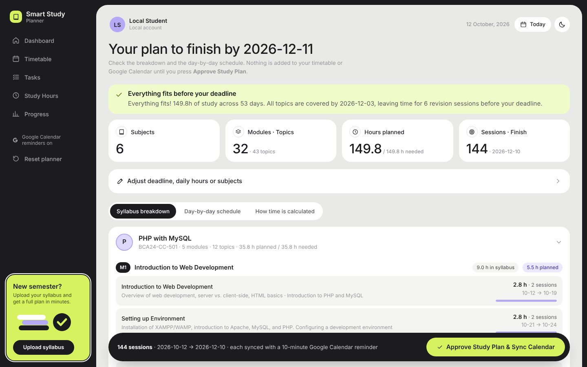
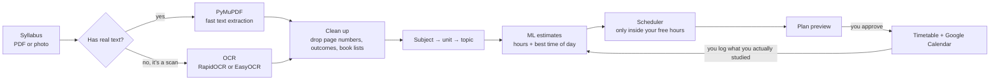
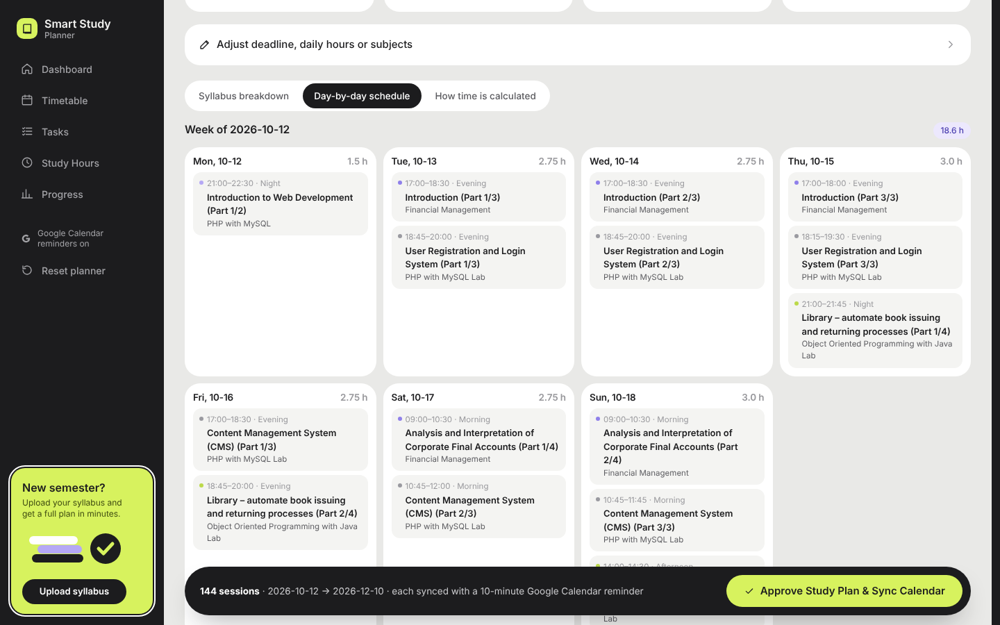
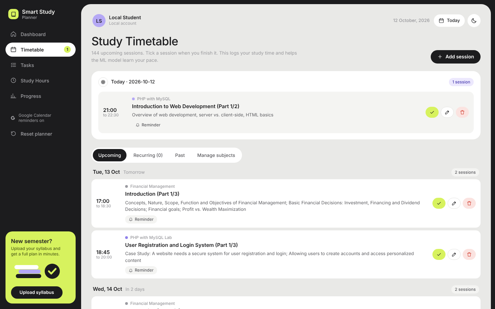
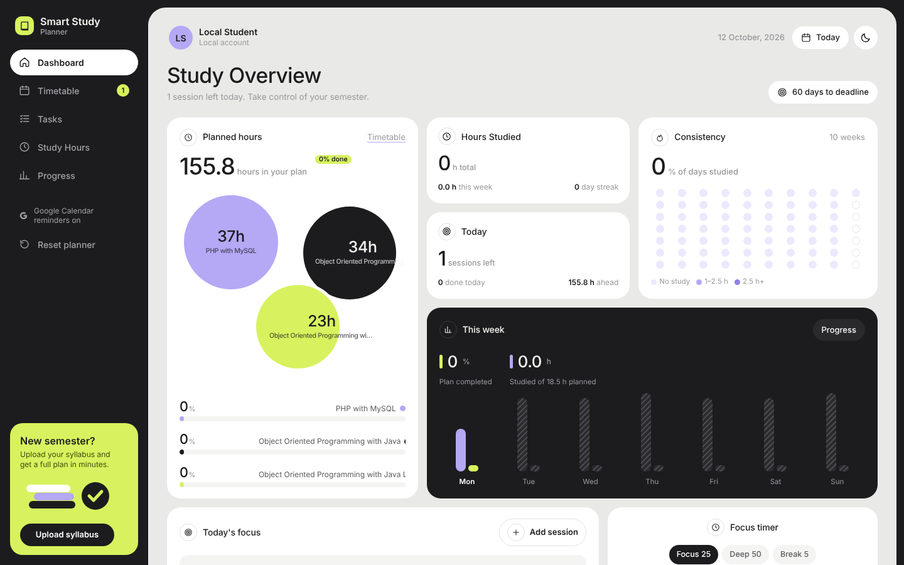
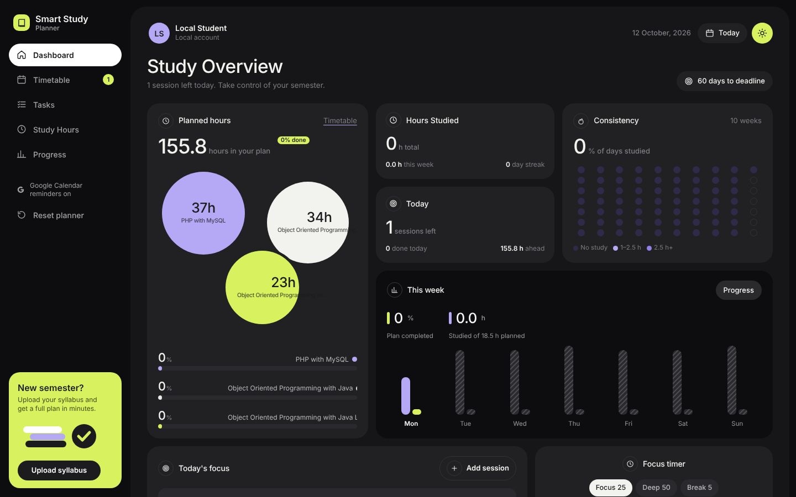

<picture>
  <source media="(prefers-color-scheme: dark)" srcset="docs/readme/banner-dark.svg">
  
</picture>

[](https://github.com/binayakmandal-hash/smart-study-planner/actions/workflows/tests.yml)


**[Try the live demo](https://smart-study-planner-3wz3.onrender.com)**. It runs on Render's free plan, so the first load can take about a minute.

A semester syllabus is a long PDF of units and topics. What you actually need is something smaller: *what do I study tonight, and for how long?*

Smart Study Planner reads the syllabus, estimates how long each topic will take, and fits those sessions into the hours you say you're free, with breaks in between. Nothing touches your Google Calendar until you've looked at the plan and approved it.



<sub>The bundled BCA Semester V syllabus becomes 6 subjects, 43 topics and 144 sessions (149.8 hours), finishing a week before the deadline so there's room for revision.</sub>

## How it works



The work is split three ways on purpose:

- **You decide when.** You set your free hours for each day. The scheduler never books a session outside them.
- **The model decides how long.** A linear regression estimates hours per topic from its length, number of subtopics, difficulty and urgency (clamped between 0.5 and 5 hours). A decision tree suggests the best time of day for it.
- **The scheduler fits it together.** Long topics are split into 1–2 hour sessions with 15-minute breaks, subjects are interleaved so you're not doing six hours of one thing, and it tells you up front if the deadline isn't realistic.

When you tick a session off, the real time you took is saved and the model retrains on it, so estimates drift toward your pace.

## Screens

<table>
  <tr>
    <td width="50%"><br><sub><b>Day by day.</b> Every session with its time, topic and subject.</sub></td>
    <td width="50%"><br><sub><b>Timetable.</b> Tick a session when you finish it.</sub></td>
  </tr>
  <tr>
    <td><br><sub><b>Dashboard.</b> Hours per subject, streaks and this week at a glance.</sub></td>
    <td><br><sub><b>Dark mode</b>, one click away.</sub></td>
  </tr>
</table>

## Features

- **Syllabus upload** for digital PDFs and scanned pages or photos. Digital pages take a fraction of a second; only pages with no real text go through OCR.
- **Sample syllabus** so you can see a full plan without uploading anything.
- **Feasibility check** before anything is saved: total hours needed against the hours you have.
- **Approve before sync.** The plan is a draft until you press *Approve Study Plan & Sync Calendar*. Each session then gets a Google Calendar event with a reminder.
- **Learns your pace** from the sessions you log.
- **Tasks, study-hour logging, progress and a focus timer** alongside the plan.
- **Accounts** with email and password, plus optional "Continue with Google".
- **Light and dark themes**, and a layout that works on a phone.

## Run it locally

You need Python 3.10 or newer.

```bash
git clone https://github.com/binayakmandal-hash/smart-study-planner.git
cd smart-study-planner
python -m venv venv
venv\Scripts\activate            # macOS / Linux: source venv/bin/activate
pip install -r requirements.txt
python app.py
```

Open http://127.0.0.1:5000, set your free hours under **My availability**, then upload a syllabus or try the sample.

`requirements.txt` includes EasyOCR, which pulls in PyTorch. If your laptop is short on space or RAM, install `requirements-render.txt` instead; it uses the much lighter RapidOCR.

### Google Calendar (optional)

1. In [Google Cloud Console](https://console.cloud.google.com/), create a project and enable the **Google Calendar API**.
2. Create an **OAuth client ID** of type *Desktop app* and save the file as `credentials.json` in the project folder.
3. The first time you approve a plan, a browser window asks you to sign in. That creates `token.json`.

Both files are in `.gitignore`. Never commit them.

For the Google sign-in button, see [GOOGLE_LOGIN_SETUP.md](GOOGLE_LOGIN_SETUP.md). To put it online, see [DEPLOY_RENDER.md](DEPLOY_RENDER.md); the public demo runs with calendar sync turned off.

## Tests

```bash
python -m unittest test_suite test_planner_v2 test_auth
```

36 tests cover syllabus cleaning, subject detection, difficulty scoring, both ML models and retraining, deadline maths, conflict-free scheduling, sign-in, and the main pages. They need no Google account or internet, and run on every push through GitHub Actions. `test_e2e_syllabus_flow.py` runs the full upload → preview → approve flow.

## Project layout

```
smart-study-planner/
├── app.py                   Flask routes, accounts, plan preview and approval
├── syllabus_processor.py    text extraction, OCR fallback, clean-up, topic parsing
├── ml_models.py             StudyTimeRegressor and StudyPeriodClassifier
├── scheduler.py             availability-first scheduling with breaks
├── google_calendar.py       Google Calendar events and reminders
├── database.py              SQLite setup
├── templates/ · static/     HTML, CSS and JavaScript (no build step)
├── sample/                  BCA Semester V syllabus used by "Try the sample"
├── test_*.py                tests
├── Dockerfile · render.yaml deployment
└── PROJECT_DOCUMENTATION.md the long technical write-up
```

The full route list, database tables and design notes are in [PROJECT_DOCUMENTATION.md](PROJECT_DOCUMENTATION.md).

## Honest limits

- The duration model starts from built-in examples, so its first estimates are generic. It gets better as you log real sessions.
- Parsing works best on syllabi with clear unit or module headings. For unusual layouts, check the subject list on the preview page before approving.
- Big scanned PDFs are slow on the free Render plan because OCR runs on a small CPU.

## Next

- Run long OCR jobs in a background queue with live progress
- An "exam readiness" score from hours logged versus topic difficulty
- Quick voice notes after a session

## License

MIT

---

Made by [Binayak Mandal](https://github.com/binayakmandal-hash), BCA student at Asansol Engineering College.
